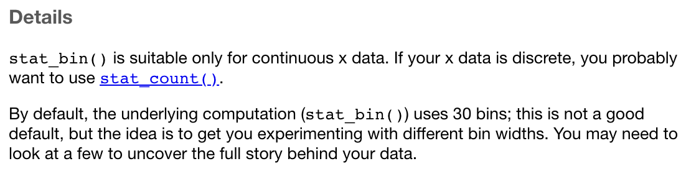

```{r}
#| cache: false
#| include: false
library(gt)
library(knitr)
library(tidyverse)
load("daten/einzelne-merkmale.Rdata")

source(rprojroot::has_file("_bcd-setup.R")$find_file("_bcd-setup.R"))
```

## Übersicht Dataframes für diese Folien

[]{.down100}

| Name                  | Inhalt                                           |
|-----------------------|--------------------------------------------------|
| `d_wb_all`            | Weltbank - Alle Länder, alle Jahre               |
| `d_wb_2012`           | Wie `d_wb_all`, aber nur für das Jahr 2012       |
| `d_wb_countries`      | Wie `d_wb_all`, aber nur ausgewählte Länder      |
| `d_wb_countries_2012` | Wie `d_wb_countries`, aber nur für das Jahr 2012 |
| `d_ns_bochum_tag`     | Tageswerte für Niederschläge in Bochum           |
| `d_ns_bochum_monat`   | Monatswerte für Niederschläge in Bochum          |

Quellen: <https://data.worldbank.org> und <https://www.dwd.de>

# Werte plotten mit `geom_col()`

Metrisches Merkmal als Höhe von Säulen darstellen

## Beispieldatensatz

::: {.columns}
::: {.column width=80%}
```{r}
d <- tibble(
  A = c("X", "Y", "X", "Z", "Z", "X"),
  B = c(1.5, 5.0, 4.5, 2.0, 1.0, 2.0),
  C = c("U", "V", "V", "W", "V", "W")
)
```
:::
::: {.column width=20%}
```{r}
#| echo: false
d
```
:::
:::

- Mit `tibble` auf die Schnelle einen Dataframe erzeugen
- Werte für ein Merkmal mit `c(...)` kombinieren
- Zeichenketten in Anführungszeichen eingeben
- Mit `<-` wird der Dataframe der Variablen `d` zugewiesen

## Minimalbeispiel

```{r}
ggplot(data = d) +
  geom_col(mapping = aes(x = A, y = B))
```

- Eine Säule für jeden Wert von Merkmal A (x)
- Höhe der Säule aus **Summe** der Werte von Merkmal B (y)

## Füllfarbe nach drittem Merkmal

```{r}
ggplot(data = d) +
  geom_col(mapping = aes(x = A, y = B, fill = C))
```

- Mit `fill = <M>` Merkmal für Füllfarbe angeben

## Alles an einer Stelle

```{r}
ggplot(data = d) +
  geom_col(mapping = aes(x = 0, y = B, fill = C))
```

- Mit festem x-Wert nur einen Balken plotten (→ Kreisdiagramm)

## Nebeneinander

```{r}
ggplot(data = d) +
  geom_col(mapping = aes(x = A, y = B, fill = C), position = "dodge")
```

- Nebeneinander anordnen mit `position = "dodge"`

## Als Balkendiagramm

```{r}
ggplot(data = d) +
  geom_col(mapping = aes(x = A, y = B, fill = C)) +
  coord_flip()
```

- Mit `coord_flip()` Koordinatenachsen vertauschen

## Mit *echten* Daten...

[]{.down150}

```{r}
d_wb_countries_2012
```

## Treibhausgasemissionen (2012)

```{r}
ggplot(data = d_wb_countries_2012) +
  geom_col(mapping = aes(x = country, y = gge))
```

- Zur Erinnerung: `gge` steht für Greenhouse Gas Emissions

## Treibhausgasemissionen bunt (2012)

```{r}
ggplot(data = d_wb_countries_2012) +
  geom_col(mapping = aes(x = country, y = gge, fill = region))
```

- Nach Weltregion eingefärbt

## Treibhausgasemissionen pro Kopf (2012)

```{r}
ggplot(data = d_wb_countries_2012) +
  geom_col(mapping = aes(x = country, y = gge / pop, fill = region))
```

- Rechnen mit Merkmalen: `y = gge / pop`

## Treibhausgasemissionen über die Zeit

```{r}
ggplot(data = d_wb_countries) +
  geom_col(mapping = aes(x = year, y = gge, fill = country))
```

- Jahreszahl für x-Achse

## Treibhausgasemissionen über die Zeit pro Kopf

```{r}
ggplot(data = d_wb_countries) +
  geom_col(mapping = aes(x = year, y = gge / pop, fill = country))
```

- Rechnen mit Merkmalen: `y = gge / pop`

## Treibhausgasemissionen anteilig

```{r}
ggplot(data = d_wb_countries) +
  geom_col(mapping = aes(x = year, y = gge, fill = country), position = "fill")
```

- Selbe Höhe für alle Balken mit `position = "fill"` $\rightarrow$ Anteile ablesbar

# Häufigkeitsverteilung mit `geom_bar()`

Wie `geom_col()` aber Ausprägungen werden gezählt

## Beispieldatensatz

::: {.columns}
::: {.column width=80%}
```{r}
d <- tibble(
  farbe = c("rot", "gruen", "blau", "gruen", "rot", "gruen")
)
```
:::
::: {.column width=20%}
```{r}
#| echo: false
d
```
:::
:::

- Nur ein Merkmal `farbe`, eine Zeile pro Beobachtung
- Wie oft jede Farbe vorkommt, ergibt sich erst durch Zählen

## Minimalbeispiel

```{r}
ggplot(data = d) +
  geom_bar(mapping = aes(x = farbe))
```

- Wie funktioniert das? Mit einer statistischen Transformation!

## Statistische Transformation


### Funktionsweise

- Daten werden vor dem Plotten transformiert
- Dabei wird eine neue Tabelle erzeugt
- Voreingestellte statistische Transformation für `geom_bar`: Zählen
- Transformierte Daten werden geplottet

## Alles an einer Stelle

```{r}
ggplot(data = d) +
  geom_bar(mapping = aes(x = 0, fill = farbe))
```

- Mit festem x-Wert nur einen Balken plotten (→ Kreisdiagramm)

## Mit *echten* Daten...

[]{.down100}

```{r}
d_wb_2012
```

## Anzahl der Länder pro Region

```{r}
ggplot(data = d_wb_2012) +
  geom_bar(mapping = aes(x = region))
```

- Funktioniert, weil jedes Land genau einmal in `d_wb_2012` vorkommt

## Anzahl der Länder pro Region

```{r}
ggplot(data = d_wb_2012) +
  geom_bar(mapping = aes(x = region, group = country), color = "black")
```

- Jedes Land ein Block: `group = country`, Umrandung mit `color`

## Anzahl der Länder pro Region

```{r}
ggplot(data = d_wb_2012) +
  geom_bar(mapping = aes(x = region, fill = region))
```

- Balken nach Region eingefärbt (redundant mit Achsenbeschriftung)

# Ring- und Kreisdiagramme

## 1. Schritt: Eine Säule mit Füllfarbe

```{r}
ggplot(data = d_wb_countries_2012) +
  geom_col(mapping = aes(x = 0, y = pop, fill = country))
```

- x-Wert fest, Höhe nach Merkmal B, Füllfarbe nach Merkmal A

## 2. Schritt: Koordinatentransformation (Kreisdiagramm)

```{r}
ggplot(data = d_wb_countries_2012) +
  geom_col(mapping = aes(x = 0, y = pop, fill = country)) +
  coord_polar(theta = "y")
```

- y-Koordinate wird für den Winkel verwendet

## 3. Schritt: Bereich auf der x-Achse (Ringdiagramm)

```{r}
ggplot(data = d_wb_countries_2012) +
  geom_col(mapping = aes(x = 0, y = pop, fill = country)) +
  coord_polar(theta = "y") +
  lims(x = c(-1.5, 0.5))
```

- Bereich auf der x-Achse mit `lims(x = c(-1.5, 0.5))` $\rightarrow$ Loch in der Mitte

## 4. Ohne Schnickschnack

```{r}
ggplot(data = d_wb_countries_2012) +
  geom_col(mapping = aes(x = 0, y = pop, fill = country)) +
  coord_polar(theta = "y") +
  lims(x = c(-1.5, 0.5)) +
  theme_void()
```

- Themes behandeln wir noch ausführlich

## Beispiel mit Häufigkeitsverteilung

```{r}
ggplot(data = d_wb_2012) +
  geom_bar(mapping = aes(x = 0, fill = region)) +
  coord_polar(theta = "y") +
  lims(x = c(-1.5, 0.5)) +
  theme_void()
```

- Mit `geom_bar` statt `geom_col`, sonst genauso

# Histogramme mit `geom_histogram()`

## Beispieldatensatz

```{r}
d <- tibble(X = c(0, 0.5, 0.6, 0.8, 1.3, 1.4, 1.5, 1.6, 1.9, 2.5, 2.6, 2.7))

ggplot(data = d) + geom_point(mapping = aes(x = X), y = 0, color = "red")
```

## Histogramm

```{r}
ggplot(data = d) +
  geom_histogram(mapping = aes(x = X)) +
  geom_point(mapping = aes(x = X), y = 0, color = "red")
```
- Hinweis vom Programm: Voreinstellung nicht gut

## Hilfetext zu geom_histogram



## Histogramm anpassen 1/5

```{r}
ggplot(data = d) +
  geom_histogram(mapping = aes(x = X), binwidth = 0.5) +
  geom_point(mapping = aes(x = X), y = 0, color = "red")
```

- Klassenbreite mit `binwidth`

## Histogramm anpassen 2/5

```{r}
ggplot(data = d) +
  geom_histogram(mapping = aes(x = X), binwidth = 0.5, boundary = 0) +
  geom_point(mapping = aes(x = X), y = 0, color = "red")
```

- Klassengrenze mit `boundary`

## Histogramm anpassen 3/5

```{r}
ggplot(data = d) +
  geom_histogram(
    mapping = aes(x = X),
    binwidth = 0.5,
    boundary = 0,
    closed = "left"
  ) +
  geom_point(mapping = aes(x = X), y = 0, color = "red")
```
- Art der Intervalle (linksoffen, rechtsoffen) mit `closed`

## Histogramm anpassen 4/5

```{r}
ggplot(data = d) +
  geom_histogram(
    mapping = aes(x = X, y = after_stat(density)),
    binwidth = 0.5,
    boundary = 0,
    closed = "left"
  ) +
  geom_point(mapping = aes(x = X), y = 0, color = "red")
```

- Relative Häufigkeiten mit `y = after_stat(density)`

## Histogramm anpassen 5/5

```{r}
ggplot(data = d) +
  geom_histogram(
    mapping = aes(x = X, y = after_stat(density)),
    breaks = c(0, 1, 1.5, 1.75, 4)
  ) +
  geom_point(mapping = aes(x = X), y = 0, color = "red")
```

- Unterschiedliche Klassengrößen mit `breaks = c(...)`

## Mit *echten* Daten...

[]{.down100}

```{r}
d_ns_bochum_tag
```

## Niederschläge (Tag) in Bochum

```{r}
ggplot(data = d_ns_bochum_tag) +
  geom_histogram(mapping = aes(x = niederschlag), binwidth = 0.5, boundary = 0)
```

## Niederschläge (Monat) in Bochum

```{r}
ggplot(data = d_ns_bochum_monat) +
  geom_histogram(mapping = aes(x = niederschlag), binwidth = 15, boundary = 0)
```

## Niederschläge (Monat, relative Häufigkeit) in Bochum

```{r}
ggplot(data = d_ns_bochum_monat) +
  geom_histogram(
    mapping = aes(x = niederschlag, y = after_stat(density)),
    binwidth = 15,
    boundary = 0
  )
```

# Verteilungsfunktionen mit `geom_step()` und Transformation

## Minimalbeispiel `geom_step()`

```{r}
ggplot(data = tibble(X = c(0, 1, 3), Y = c(2, 1, 3))) +
  geom_step(mapping = aes(x = X, y = Y)) +
  geom_point(mapping = aes(x = X, y = Y), color = "red")
```

## Beispieldaten

```{r}
#| fig-asp: 0.3
d <- tibble(
  X = c(0.0, 0.3, 0.2, 0.6, 0.3, 0.9, 1.0, 0.3, 0.6, 0.3),
  Y = c("a", "a", "a", "b", "b", "b", "a", "b", "a", "b")
)
ggplot(data = d) +
  geom_dotplot(
    mapping = aes(x = X, fill = Y),
    stackgroups = TRUE,
    dotsize = 0.5
  )
```

## Empirische Verteilungsfunktion

```{r}
ggplot(data = d) +
  geom_dotplot(mapping = aes(x = X), dotsize = 0.5) +
  geom_step(mapping = aes(x = X), stat = "ecdf")
```

- `stat = "ecdf"` meint *Empirical Cumulative Densitiy Function*

## Empirische Verteilungsfunktion getrennt

```{r}
ggplot(data = d) +
  geom_dotplot(
    mapping = aes(x = X, fill = Y),
    stackgroups = TRUE,
    dotsize = 0.5
  ) +
  geom_step(mapping = aes(x = X, color = Y), stat = "ecdf")
```

- Für jede Ausprägung von Merkmal `Y` eine Kurve

## Absolute kumulierte Häufigkeitsverteilung

```{r}
ggplot(data = d) +
  geom_dotplot(mapping = aes(x = X), dotsize = 0.5) +
  geom_step(mapping = aes(x = X, y = nrow(d) * after_stat(y)), stat = "ecdf")
```

- In ggplot nicht vorgesehen und daher kompliziert

## Mit *echten* Daten...

## Monatliche Niederschläge

```{r}
ggplot(data = d_ns_bochum_monat) +
  geom_step(mapping = aes(x = niederschlag), stat = "ecdf")
```

- So gut wie kein Monat ohne Regen

## Tägliche Niederschläge

```{r}
ggplot(data = d_ns_bochum_tag) +
  geom_step(mapping = aes(x = niederschlag), stat = "ecdf")
```

- Warum ganz anders als für die monatlichen Niederschläge?

# Zusammenfassung

## Werte darstellen mit `geom_col()`

```{.r}
ggplot(data = d) +
  geom_col(mapping = aes(x = <M>, y = <M>, fill = <M>, color = <M>), Argumente)
```

[]{.down60}

| Aesthetics   | Beschreibung                       | Optional                  |
|--------------|------------------------------------|---------------------------|
| `x`          | Merkmal für x-Position             | Nein                      |
| `y`          | Merkmal für Höhe der Balken        | Nein                      |
| `fill`       | Merkmal für Füllfarbe              | Ja                        |
| `color`      | Merkmal für Linienfarbe            | Ja                        |

: {tbl-colwidths="[20, 65, 15]"}

[]{.down60}

| Argumente    | Beschreibung                                                   |
|--------------|----------------------------------------------------------------|
| `position`   | Gesamte y-Achse mit `position = "fill"`                        |
|              | Balken nebeneinander mit `position = "dodge"`                  |

: {tbl-colwidths="[20, 80]"}

## Zählen und darstellen mit `geom_bar()`

```{.r}
ggplot(data = d) +
  geom_bar(mapping = aes(x = <M>, fill = <M>, color = <M>), Argumente)
```

[]{.down60}


| Aesthetics   | Beschreibung                       | Optional                   |
|--------------|------------------------------------|----------------------------|
| `x`          | Merkmal für x-Achse (wird gezählt) | Nein                       |
| `fill`       | Füllfarbe                          | Ja                         |
| `color`      | Linienfarbe                        | Ja                         |

: {tbl-colwidths="[20, 65, 15]"}

[]{.down60}

| Argumente    | Beschreibung                                                    |
|--------------|-----------------------------------------------------------------|
| `position`   | Gesamte y-Achse mit `position = "fill"`                         |
|              | Balken nebeneinander mit `position = "dodge"`                   |

: {tbl-colwidths="[20, 80]"}

$\rightarrow$ Wie `geom_col` aber ohne y

## Histogramme mit `geom_histogram()`

```{.r}
ggplot(data = d) +
  geom_histogram(mapping = aes(x = <M>, y = after_stat(density), fill = <M>), Argumente)
```

[]{.down30}

| Aesthetics   | Beschreibung                                         | Optional |
|--------------|------------------------------------------------------|----------|
| `x`          | Merkmal, das gezählt werden soll                     | Nein     |
| `y`          | Relative Häufigkeiten mit `y = after_stat(density))` | Ja       |
| `fill`       | Merkmal für Füllfarbe                                | Ja       |

: {tbl-colwidths="[20, 65, 15]"}

[]{.down30}

| Argumente    | Beschreibung                                                    |
|--------------|-----------------------------------------------------------------|
| `bins`       | Anzahl der Klassen                                              |
| `binwidth`   | Klassenbreite                                                   |
| `center`     | Mitte einer Klasse                                              |
| `boundary`   | Grenze zwischen zwei Klassen                                    |
| `breaks`     | Klassengrenzen                                                  |
| `closed`     | Intervalle geschlossen ("left" oder "right")                    |

: {tbl-colwidths="[20, 80]"}

## Empirische Verteilungsfunktion mit `geom_step()`

```{.r}
ggplot(data = d) +
  geom_step(mapping = aes(x = <M>, color = <M>), stat = "ecdf")
```

[]{.down60}

| Aesthetics   | Beschreibung                                         | Optional |
|--------------|------------------------------------------------------|----------|
| `x`          | Merkmal für empirische Verteilungsfunktion           | Nein     |
| `color`      | Merkmal für Farbe                                    | Ja       |

: {tbl-colwidths="[20, 65, 15]"}
