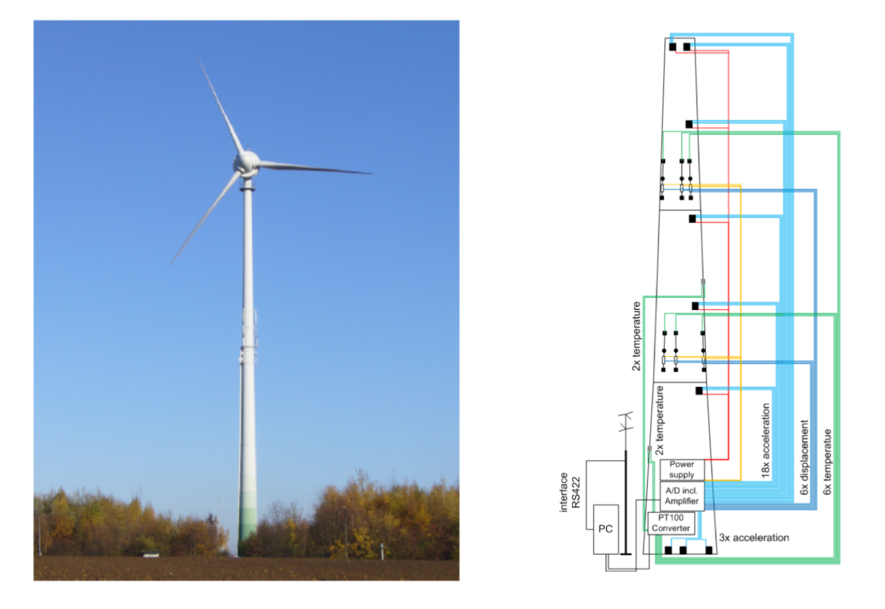
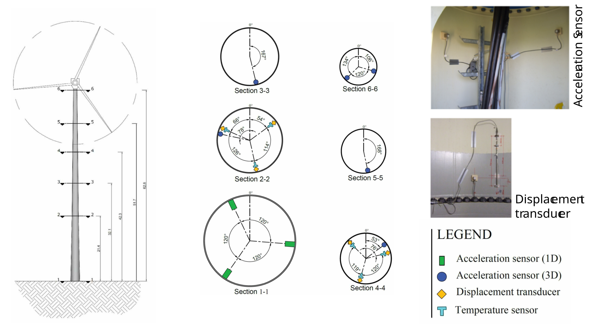

::: {#exr-korrelationskoeffizient-und-ausgleichsgerade-in-r}
## Korrelationskoeffizient und Ausgleichsgerade in R

Sie untersuchen Messdaten von einer Windkraftanlage in Dortmund (Forschungsprojekt an der Ruhr-Universität Bochum) (daten/zwei-merkmale-aufgaben-2.Rdata). Die Daten wurden freundlicherweise von Prof. Rüdiger Höffer zur Verfügung gestellt.

{width=60% fig-align="center"}

{width=60% fig-align="center"}

Anmerkungen:

- Daten werden mit einer Frequenz von 100 Hz aufgezeichnet
- Datenvolumen rund 140 GB pro Jahr

### Linienplot

Plotten Sie die Windgeschwindigkeit über die Zeit in einem Linienplot (`geom_line()`). Welche der Merkmale `datum` oder `zeit` ist Ihrer Meinung nach besser geeignet?

Zusatzfrage: Die Windgeschwindigkeit ist in Meter pro Sekunde angegeben. War es in dem Messzeitraum sehr windig?

### Streuplots

Stellen Sie folgende Zusammenhänge in Streuplots dar:

-   Windgeschwindigkeit (`v_wind`) und Drehzahl (`drehzahl`).
-   Windgeschwindigkeit (`v_wind`) und Leistung (`leistung`).
-   Drehzahl (`drehzahl`) und Leistung (`leistung`).
-   Windgeschwindigkeit (`v_wind`) und Beschleunigung (`B6_y`).
-   Windgeschwindigkeit (`v_wind`) und Verformung (`w5`).

Berechnen Sie dabei jeweils den Korrelationskoeffizienten $r$ und plotten Sie die Regressionsgerade.

### Andere Darstellungsformen

Experimentieren Sie mit anderen Darstellungsformen (2D-Histogramm, Dichten) für den Zusammenhang zwischen Windgeschwindigkeit und Verformung.

::: {.tinh-solution}
```{r}
#| include: false
library(tidyverse)
load("daten/zwei-merkmale-aufgaben-1.Rdata")
load("daten/zwei-merkmale-aufgaben-2.Rdata")
```

**Windgeschwindigkeit über die Zeit**

```{r}
ggplot(data = d_wea_min) +
  geom_line(mapping = aes(x = datum, y = v_wind))
```

**Streuplots**

Windgeschwindigkeit und Drehzahl

```{r}
ggplot(data = d_wea_min, mapping = aes(x = v_wind, y = drehzahl)) +
  geom_point() +
  geom_smooth(formula = y ~ x, method = "lm")
```

```{r}
cor(d_wea_min$v_wind, d_wea_min$drehzahl)
```

Windgeschwindigkeit und Leistung

```{r}
ggplot(data = d_wea_min, mapping = aes(x = v_wind, y = leistung)) +
  geom_point() +
  geom_smooth(formula = y ~ x, method = "lm")
```

```{r}
cor(d_wea_min$v_wind, d_wea_min$leistung)
```

Drehzahl und Leistung

```{r}
ggplot(data = d_wea_min, mapping = aes(x = drehzahl, y = leistung)) +
  geom_point() +
  geom_smooth(formula = y ~ x, method = "lm")
```

```{r}
cor(d_wea_min$drehzahl, d_wea_min$leistung)
```

Windgeschwindigkeit und Beschleunigung

```{r}
ggplot(data = d_wea_min, mapping = aes(x = v_wind, y = B6_y)) +
  geom_point() +
  geom_smooth(formula = y ~ x, method = "lm")
```

```{r}
cor(d_wea_min$v_wind, d_wea_min$B6_y)
```

Windgeschwindigkeit und Verformung

```{r}
ggplot(data = d_wea_min, mapping = aes(x = v_wind, y = w5)) +
  geom_point() +
  geom_smooth(formula = y ~ x, method = "lm")
```

```{r}
cor(d_wea_min$v_wind, d_wea_min$w5)
```

**Andere Darstellungsformen**

Selber ausprobieren
:::
:::
